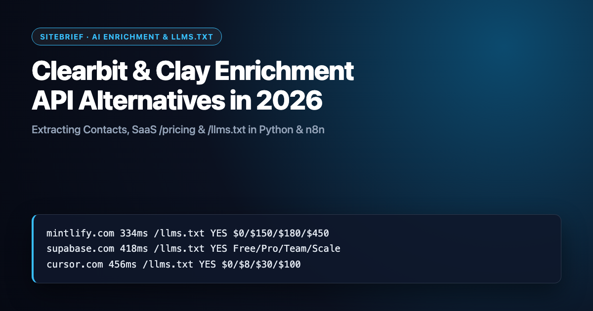

# Website Contacts, Socials, Pricing & LLM Brief — REST API & MCP Server

[](https://glama.ai/mcp/servers/yun87457-web/website-contacts-pricing-mcp)
[](https://glama.ai/mcp/connectors/io.github.yun87457-web/website-contacts-pricing-intel-mcp)
[](https://mcpservers.org/servers/yun87457-web/website-contacts-pricing-mcp)

Extract verified emails (with role classification), phone numbers, `12+` social profiles, SaaS `/pricing` tiers & PLG flags, DNS `MX`/`SPF` email provider signals, and `/llms.txt` or clean Markdown company briefs from any company domain or work email.

### `/llms.txt` Conditional Freshness & Live `/pricing` Isolation (`v1.1`)
- **Exposes HTTP cache validators:** Every `/llms.txt` enrichment returns `llmsTxtEtag`, `llmsTxtLastModified`, `llmsTxtCacheControl`, `llmsTxtCacheStatus` (`miss` | `hit` | `revalidated_304` | `not_modified_304`), `llmsTxtNotModified`, and `llmsTxtFetchedAt`.
- **Short-TTL revalidation (`If-None-Match` / `If-Modified-Since`):** Caps overly long upstream `Cache-Control` headers with a configurable short local TTL (`llmsCacheTtlSeconds`, default `300s`, `0–3600s`) and supports stateless caller validators (`llmsIfNoneMatch`, `llmsIfModifiedSince`) handling `HTTP 304 Not Modified` without re-downloading unchanged bodies.
- **Pricing never goes stale:** `/pricing` pages are always fetched live (`Cache-Control: no-cache`) completely independently of `/llms.txt` caching, so pricing tier changes appear immediately even when a domain serves long `Cache-Control` headers on `/llms.txt`.

## Access Channels

- **Apify Store (Batch + Standby + 10,000 Free Domains/mo):** https://apify.com/spiky_closet/website-contacts-pricing-intel
- **RapidAPI Hub (REST API, 500 Free Requests/mo):** https://rapidapi.com/HYunLe/api/website-contacts-socials-pricing-llm-brief-api
- **Official MCP Registry:** `io.github.yun87457-web/website-contacts-pricing-intel-mcp`

## Verified Performance (50-Domain Batch Benchmark)

- **50 mixed domains (`concurrency: 12`, including WAF 403 & dead domains):** `11.65 s` runtime, `110.5 MB` peak RAM, `0` crashes, automatic cross-format deduplication, DNS preservation and `$0` billing on WAF-blocked/unreachable domains.

## MCP Tools (Streamable HTTP)

Endpoint: `https://spiky-closet--website-contacts-pricing-intel.apify.actor/mcp`

| Tool | Description |
|---|---|
| `enrich_company_website` | Extract contacts, socials, `/pricing` tiers, DNS `MX`/`SPF`, and `/llms.txt` or Markdown brief for a single domain or work email. |
| `batch_enrich_domains` | Deduplicate and enrich a batch of company domains in parallel. |
| `extract_page_markdown` | Convert any public web page URL into clean, token-efficient Markdown. |

## Claude Desktop / Cursor MCP Configuration

```json
{
  "mcpServers": {
    "website-contacts-pricing-intel": {
      "url": "https://spiky-closet--website-contacts-pricing-intel.apify.actor/mcp",
      "headers": {
        "Authorization": "Bearer YOUR_APIFY_TOKEN"
      }
    }
  }
}
```

## REST Quick Start (cURL)

```bash
curl -sG "https://website-contacts-socials-pricing-llm-brief-api.p.rapidapi.com/enrich" \
  --data-urlencode "domain=stripe.com" \
  -H "x-rapidapi-key: YOUR_RAPIDAPI_KEY" \
  -H "x-rapidapi-host: website-contacts-socials-pricing-llm-brief-api.p.rapidapi.com"
```

## Free n8n Workflow Template

Import the ready-to-run workflow (**B2B Domain Contacts, SaaS /pricing & /llms.txt Brief Enricher**): [`n8n-template.json`](./n8n-template.json)

1. Download [`n8n-template.json`](./n8n-template.json) and click **Import from File** in n8n.
2. Add a Generic Header Auth credential (`x-rapidapi-key`) using your free RapidAPI key.
3. Replace the sample domain list and connect your Slack channel.

## Ready-to-Run Presets (Apify Public Tasks)
- [B2B Website Email, Phone & Social Links Extractor](https://apify.com/spiky_closet/website-contacts-pricing-intel/examples/b2b-website-email-phone-social-extractor)
- [SaaS Pricing Page & Tier Plan Extractor](https://apify.com/spiky_closet/website-contacts-pricing-intel/examples/saas-pricing-page-tier-scraper)
- [Website to Clean LLM Markdown & llms.txt Extractor](https://apify.com/spiky_closet/website-contacts-pricing-intel/examples/website-to-llm-markdown-llms-txt-brief)
## Live Interactive Top-100 Benchmark (Nov 2026)

Explore our live open dataset of **100 leading DevTools & AI companies** enriched in `8.37s` (`0` crashes):
- **Interactive Web Explorer:** https://yun87457-web.github.io/website-contacts-pricing-mcp/
- **Open Downloads (MIT):** [`benchmarks/top-100-nov-2026.csv`](./benchmarks/top-100-nov-2026.csv) · [`benchmarks/top-100-nov-2026.json`](./benchmarks/top-100-nov-2026.json)
- **Key Findings:** **`80%`** already ship `/llms.txt` for AI agents, with public `/pricing` tier structures, PLG free-tier flags, and usage-based billing signals extracted in a single call.

## Install & Run Locally (Stdio MCP Server — Zero Dependencies)

Run directly in Claude Desktop, Cursor, Windsurf, or Cline using Node.js 18+ (supports either `APIFY_TOKEN` or `RAPIDAPI_KEY`):

```bash
npx -y github:yun87457-web/website-contacts-pricing-mcp
```

```json
{
  "mcpServers": {
    "website-contacts-pricing": {
      "command": "npx",
      "args": ["-y", "github:yun87457-web/website-contacts-pricing-mcp"],
      "env": { "RAPIDAPI_KEY": "YOUR_FREE_RAPIDAPI_KEY" }
    }
  }
}
```

## No-Code Recipes (n8n, Make.com & Clay)

- **n8n Workflow JSON:** [`n8n-template.json`](./n8n-template.json) (and community node scaffold in [`n8n-community-node/`](./n8n-community-node/))
- **Clay HTTP Enrichment:** [`integrations/clay-http-enrichment.json`](./integrations/clay-http-enrichment.json)
- **Make.com HTTP Module:** [`integrations/make-http-module.json`](./integrations/make-http-module.json)
